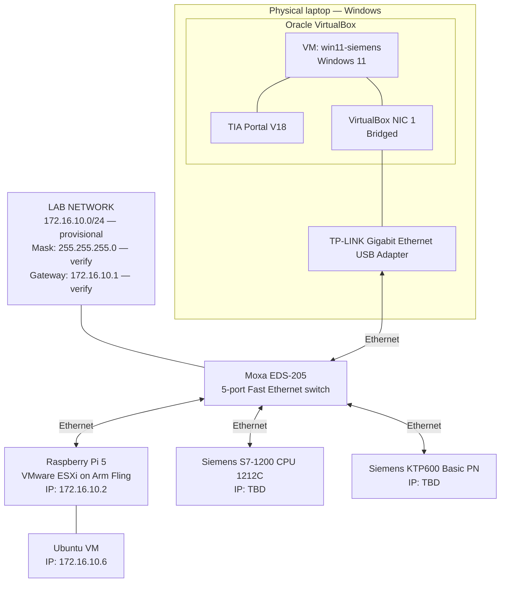

# Network Architecture

## Network Configuration

| Parameter | Value |
|---|---|
| Network | `172.16.10.0/24` *(provisional)* |
| Subnet mask | `255.255.255.0` *(verify)* |
| Default gateway | `172.16.10.1` *(Windows ICS, if enabled)* |
| DNS | Verify actual configuration |
| Topology | Single Ethernet LAN |
| Industrial switch | Moxa EDS-205 |
| VLANs | None configured |

## Network Topology

## Known IP Addresses

| Device | IP address | Subnet mask | Status |
|---|---|---|---|
| Laptop / ICS interface | `172.16.10.1` | Verify | Previously reported |
| ESXi management | `172.16.10.2` | Verify | Previously reported |
| Ubuntu VM | `172.16.10.6` | `255.255.0.0` reported earlier | Verify current config |
| PLC | TBD | TBD | Not confirmed |
| HMI | TBD | TBD | Not confirmed |
| Windows 11 VirtualBox VM | TBD | TBD | Check inside guest OS |

## Notes

- VirtualBox Adapter 1 is configured as Bridged to
  `TP-LINK Gigabit Ethernet USB Adapter`.
- TIA Portal V18 runs inside the Windows 11 guest VM.
- The laptop, PLC, HMI and ESXi management interface are intended
  to communicate over one shared Ethernet LAN.
- Confirm the actual subnet mask and IP addresses before treating
  this document as the final network configuration.
- Do not publish credentials, private keys or access tokens.

