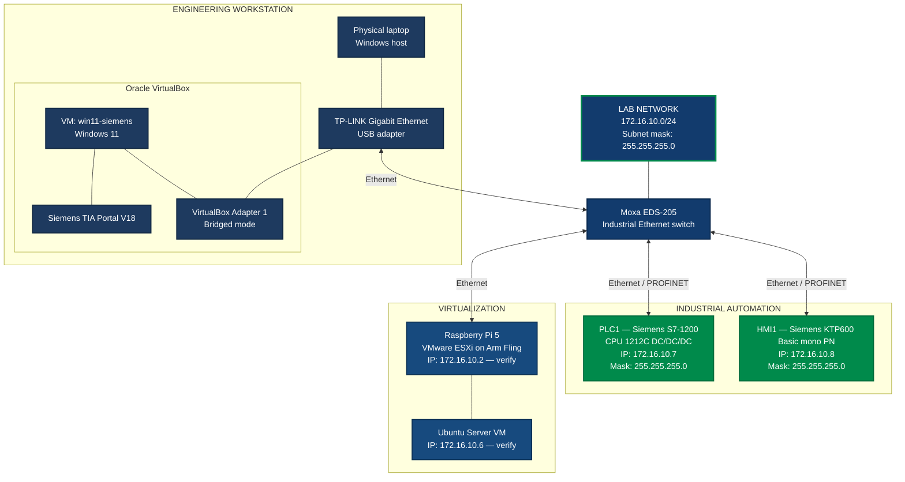

# Network Architecture

**Project:** Industry DevOps Lab  
**Document:** Network Configuration and Topology  
**Status:** In progress — selected IP addresses verified in TIA Portal

---

## 1. Network Overview

The laboratory uses a shared Ethernet network for industrial automation, virtualization and engineering access.

| Parameter | Value |
|---|---|
| Network address | `172.16.10.0/24` |
| Subnet mask | `255.255.255.0` |
| Default gateway | `172.16.10.1` — verify current configuration |
| Industrial switch | Moxa EDS-205 |
| Network topology | Single Ethernet LAN |
| VLANs | None configured |
| PLC engineering software | Siemens TIA Portal V18 |
| Virtualization platform | VMware ESXi on Arm Fling |
| Hypervisor for engineering VM | Oracle VirtualBox |

## 2. Network Topology

The following diagram describes the intended logical topology. The PLC and HMI addresses are based on the TIA Portal configuration screenshots.

## 3. IP Address Allocation

| Device | IPv4 address | Subnet mask | Status |
|---|---|---|---|
| Network | `172.16.10.0` | `255.255.255.0` | Defined for documentation |
| Laptop / ICS interface | `172.16.10.1` | `255.255.255.0` | Previously reported |
| ESXi management | `172.16.10.2` | `255.255.255.0` | Previously reported |
| Windows 11 VM — win11-devops | `172.16.10.5` | Verify | Previously reported |
| Windows 11 VM — win11-siemens, TIA Portal V18 | `172.16.10.6` | Verify | Previously reported |
| Siemens S7-1200 PLC | `172.16.10.7` | `255.255.255.0` | Confirmed in TIA Portal |
| Siemens KTP600 HMI | `172.16.10.8` | `255.255.255.0` | Confirmed in TIA Portal |
| Moxa EDS-205 | No management IP expected | N/A | Unmanaged switch |

**Note:** `172.16.10.0` is the network address, not an address to assign to a device. The broadcast address for this `/24` network is `172.16.10.255`.

## 4. PLC and HMI Configuration

The following settings are visible in the TIA Portal project:

| Parameter | PLC1 | HMI1 |
|---|---|---|
| Device | SIMATIC S7-1200 CPU 1212C DC/DC/DC | KTP600 Basic mono PN |
| Interface | PROFINET interface | PROFINET interface |
| Subnet name | `PN/IE_1` | `PN/IE_1` |
| IPv4 address | `172.16.10.7` | `172.16.10.8` |
| Subnet mask | `255.255.255.0` | `255.255.255.0` |

The PLC and HMI are configured in the same IPv4 subnet. Their actual communication should be tested after confirming physical connections and downloading the relevant configuration.

## 5. Engineering Workstation

TIA Portal V18 runs inside a Windows 11 virtual machine hosted by Oracle VirtualBox.

| Parameter | Configuration |
|---|---|
| Virtual machine name | `win11-siemens` |
| Guest operating system | Windows 11 |
| Engineering software | Siemens TIA Portal V18 |
| Virtual network adapter | Adapter 1 |
| VirtualBox network mode | Bridged Adapter |
| Selected host interface | TP-LINK Gigabit Ethernet USB Adapter |
| Cable Connected | Enabled in VirtualBox |

In bridged mode, the Windows 11 guest uses the selected physical network interface to access the Ethernet LAN. The guest's own IPv4 address must be checked inside Windows 11; it is not necessarily the same as the physical laptop's address.

## 6. Industrial Ethernet Switch

**Device:** Moxa EDS-205

The EDS-205 is an unmanaged industrial Ethernet switch with five 10/100 Mbps Ethernet ports.

Proposed port allocation:

| Switch port | Connected device |
|---|---|
| Port 1 | Siemens S7-1200 PLC |
| Port 2 | Siemens KTP600 Basic mono PN HMI |
| Port 3 | Raspberry Pi 5 / ESXi |
| Port 4 | Laptop engineering connection via TP-LINK USB Ethernet |
| Port 5 | Spare port |

This is a proposed allocation, not a verified record of the current cabling. Record the actual port assignments after checking the physical installation.

The switch is unmanaged; do not assume it provides configurable VLAN segmentation.

## 7. Network Verification Checklist

- [ ] Verify the physical laptop's IPv4 address and subnet mask.
- [ ] Verify the Windows 11 guest IPv4 address and subnet mask.
- [ ] Verify ESXi management IP and subnet mask.
- [ ] Verify the Ubuntu VM IP, mask and default gateway.
- [ ] Confirm the physical switch port used by each device.
- [ ] Test connectivity between the engineering VM and the PLC.
- [ ] Confirm that TIA Portal can discover and access the PLC.
- [ ] Confirm HMI-to-PLC communication.
- [ ] Confirm whether Windows Internet Connection Sharing is enabled and which interface provides the gateway.
- [ ] Confirm that all intended devices use the same subnet.

## 8. Documentation Notes

- This document describes a shared Ethernet LAN with no configured VLANs.
- The PLC and HMI IP addresses and subnet masks are taken from the supplied TIA Portal screenshots.
- Other IP addresses are provisional until verified on the respective devices.
- The diagram is a logical topology, not a verified as-built wiring drawing.
- Do not publish passwords, private keys, access tokens or other credentials in the public repository.
- Keep detailed sensitive operational information in a separate private repository.

