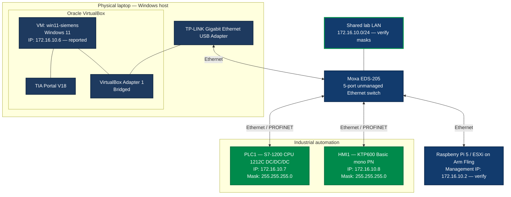

# Network Configuration

## Network overview

The intended topology is one shared Ethernet LAN for engineering access, the PLC/HMI and the ESXi host. No VLAN segmentation is currently documented.

| Parameter | Value | Status |
|---|---|---|
| Network | `172.16.10.0/24` | Intended; verify actual masks on every device |
| Subnet mask | `255.255.255.0` | Confirmed for PLC and HMI in TIA Portal |
| Gateway | `172.16.10.1` | Previously reported for laptop/ICS; verify current routing |
| Industrial switch | Moxa EDS-205 | Model reported |
| VLANs | None configured | Current design |
| Engineering software | TIA Portal V18 inside Windows 11 VM | Reported |
| VirtualBox mode for `win11-siemens` | Bridged Adapter | Previously documented |
| VirtualBox mode for `win11-devops` | Bridged Adapter + NAT | Tested |
| Bridged host interface | TP-LINK Gigabit Ethernet USB Adapter | Previously documented for `win11-siemens`; verify if needed |

## Logical topology

> **Important:** The existing network diagram below is intentionally preserved. The new `win11-devops` VM is documented in a separate section without changing the original topology.



This is a logical topology. Confirm the actual physical port assignments and cable routing in the lab.

## IP address allocation

| Device | IPv4 address | Subnet mask | Status |
|---|---|---|---|
| Network address | `172.16.10.0` | `/24` | Network identifier, not a host address |
| Laptop / ICS interface | `172.16.10.1` | Verify | Previously reported |
| Raspberry Pi 5 / ESXi management | `172.16.10.2` | Verify | Previously reported |
| Windows 11 VM `win11-devops` — bridged adapter | `172.16.10.5` | `255.255.255.0` | Confirmed |
| Windows 11 VM `win11-siemens` | `172.16.10.6` | Verify in guest OS | User-reported |
| Siemens S7-1200 PLC | `172.16.10.7` | `255.255.255.0` | Confirmed in TIA Portal screenshot |
| Siemens KTP600 Basic mono PN | `172.16.10.8` | `255.255.255.0` | Confirmed in TIA Portal screenshot |
| `win11-devops` — VirtualBox NAT adapter | VirtualBox-assigned | VirtualBox-managed | Internet connectivity tested; address not recorded |
| Additional Linux VM(s) | TBD | TBD | Do not assign an address in documentation until verified |
| Moxa EDS-205 | No management IP expected | N/A | Unmanaged switch |

For a `/24` network, the broadcast address is `172.16.10.255`. The address `172.16.10.0` is the network address and should not be assigned to a device.

## PLC and HMI

The supplied TIA Portal screenshots show:

| Parameter | PLC1 | HMI1 |
|---|---|---|
| Model | SIMATIC S7-1200 CPU 1212C DC/DC/DC | KTP600 Basic mono PN |
| TIA Portal subnet | `PN/IE_1` | `PN/IE_1` |
| IPv4 address | `172.16.10.7` | `172.16.10.8` |
| Subnet mask | `255.255.255.0` | `255.255.255.0` |

## VirtualBox engineering VM — `win11-siemens`

| Parameter | Value |
|---|---|
| VM name | `win11-siemens` |
| Guest OS | Windows 11 |
| Software | Siemens TIA Portal V18 |
| Adapter | Adapter 1 |
| Network mode | Bridged Adapter |
| Host interface | TP-LINK Gigabit Ethernet USB Adapter |
| Virtual cable | Connected option enabled |

The guest's IP configuration must be checked inside Windows 11 using `ipconfig`. Bridged mode does not mean the guest shares the host's IP address.

## VirtualBox DevOps VM — `win11-devops`

The `win11-devops` virtual machine is a separate development workstation dedicated to the DevOps part of the `industry-devops-lab` project.

It is distinct from `win11-siemens`. Its purpose is to provide a clean environment for Git, infrastructure as code, PowerShell and project development without changing the existing TIA Portal workstation.

### VM and network configuration

| Parameter | Value |
|---|---|
| VM name | `win11-devops` |
| Guest OS | Windows 11 |
| Hypervisor | Oracle VirtualBox |
| Network adapter 1 | Bridged Adapter |
| Bridged physical interface | USB Ethernet adapter |
| Bridged IPv4 address | `172.16.10.5` |
| Bridged subnet mask | `255.255.255.0` |
| Bridged network | `172.16.10.0/24` |
| Network adapter 2 | VirtualBox NAT |
| NAT purpose | Internet access from the VM |
| Internet connectivity | Tested successfully |
| Access to ESXi management address | Tested successfully |

The bridged adapter provides access to the laboratory network. The NAT adapter provides a separate path to the Internet because the laboratory network does not provide Internet access.

The NAT adapter's current IPv4 address has not been recorded in this document.

### Installed software and versions

The following software has been installed and its version or execution verified.

| Software | Version | Purpose | Status |
|---|---|---|---|
| Git for Windows | `2.56.0.windows.3` | Source control and repository management | Installed and verified |
| Visual Studio Code | `1.141.2` | Code and configuration editing | Installed and verified |
| Terraform CLI | `1.16.6` (`windows_amd64`) | Infrastructure as code | Installed and verified |
| PowerShell 7 | `7.6.8` | Automation and administration scripts | Installed and verified |

The following Visual Studio Code extensions are installed:

| Extension | Extension ID | Status |
|---|---|---|
| HashiCorp Terraform | `HashiCorp.terraform` | Installed |
| Red Hat YAML | `redhat.vscode-yaml` | Installed |

The extension versions have not been recorded.

**Versioning note:** Terraform CLI and the Visual Studio Code Terraform extension are separate components. Installing the extension provides editor support; it does not replace the Terraform CLI.

### Connectivity verification

The following tests have been performed from `win11-devops`.

| Test | Command or method | Result |
|---|---|---|
| Reachability of Raspberry Pi / ESXi | `ping 172.16.10.2` | Passed |
| TCP connectivity to ESXi SSH | `Test-NetConnection 172.16.10.2 -Port 22` | `TcpTestSucceeded: True` |
| Internet connectivity and DNS resolution | `ping www.google.com` | Passed |
| Git CLI | `git --version` | Passed |
| Terraform CLI | `terraform version` | Passed |
| PowerShell 7 | `$PSVersionTable.PSVersion` in `pwsh` | Passed |

The successful TCP test confirms connectivity to port 22 on the ESXi management address. It does not, by itself, verify SSH authentication or authorization.

The successful Internet ping confirms that name resolution and ICMP connectivity worked at the time of the test. It does not guarantee that every Internet service is accessible.

### Routing considerations

The expected network behavior is:

- Traffic for `172.16.10.0/24` uses the bridged laboratory interface.
- General Internet traffic uses the VirtualBox NAT interface.
- The VM should not route traffic between the bridged interface and NAT.
- IP forwarding or bridging between the two adapters must not be enabled unless it is explicitly required and documented.

The actual routing table and NAT adapter address have not yet been recorded. If routing problems arise, inspect the configuration with:

```powershell
ipconfig /all
route print
```

### Role in the project

The `win11-devops` VM is intended for:

- Git-based source control.
- Editing Terraform, YAML, PowerShell and other project files.
- Infrastructure-as-code development and validation.
- Automation scripts and deployment tooling.
- Future CI/CD workflow development.
- Accessing the lab and ESXi management services when required.

The VM is a development workstation. Its presence does not imply that the project's Linux VMs, Docker containers or CI/CD pipeline have already been deployed.

## Proposed switch port allocation

| Moxa EDS-205 port | Proposed connection |
|---|---|
| 1 | Siemens S7-1200 PLC |
| 2 | KTP600 HMI |
| 3 | Raspberry Pi 5 / ESXi |
| 4 | Laptop Ethernet adapter |
| 5 | Spare |

This port allocation is a proposal, not a confirmed as-built record. The EDS-205 is unmanaged; do not assume configurable VLAN support.

The new `win11-devops` VM uses the bridged USB Ethernet interface for laboratory access. Its precise physical cabling and relationship to the existing switch-port allocation should be confirmed against the actual host and VirtualBox configuration.

## Verification checklist

- [ ] Confirm actual mask and gateway on the laptop's USB Ethernet interface.
- [ ] Run `ipconfig /all` inside `win11-siemens`.
- [ ] Verify ESXi management IP and mask.
- [ ] Confirm current physical cable/port assignments.
- [ ] Test TIA Portal discovery and PLC reachability.
- [ ] Test HMI-to-PLC communication.
- [ ] Verify which interface, if any, provides Internet Connection Sharing (ICS).
- [ ] Record the NAT adapter's IPv4 address in `win11-devops`.
- [ ] Verify the routing table in `win11-devops` with `route print`.
- [ ] Record the exact versions of the installed VS Code extensions if required.
- [ ] Document each additional Linux VM only after it is deployed and its address is confirmed.

## Security

Do not publish passwords, tokens, private keys, VPN credentials or other secrets. Detailed sensitive operational notes belong in a separate private repository.

Keep the DevOps VM's NAT and bridged adapters separate. Do not enable IP forwarding or create a bridge between them unless the network design explicitly requires it.

Do not expose PLC, HMI or ESXi management services directly to the public Internet. Restrict management access to authorized devices and networks.
