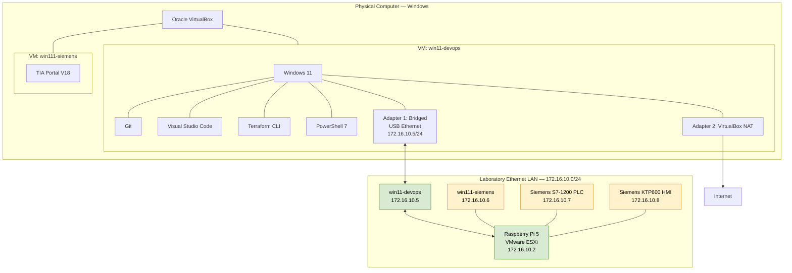

# Network Configuration

## 1. Overview

The `industry-devops-lab` project uses a dedicated Ethernet laboratory network for communication between the industrial devices, the virtualization host and the engineering workstations.

The laboratory subnet is:

- **Network:** `172.16.10.0/24`
- **Subnet mask:** `255.255.255.0`
- **VLANs:** None currently configured
- **Primary purpose:** Industrial communication, laboratory management and access to the virtualization host

The network is isolated from direct Internet access through the laboratory router. The `win11-devops` virtual machine therefore uses a second network adapter configured with VirtualBox NAT to access the Internet.

> **Documentation status:** IP addresses and connectivity tests below reflect the currently reported configuration. Details not yet verified are explicitly marked as unverified.

## 2. Network Diagram

**Diagram notes:**

- `win11-devops` is a Windows 11 virtual machine running under Oracle VirtualBox.
- Adapter 1 is bridged to the physical USB Ethernet adapter and connects to the laboratory LAN.
- Adapter 2 uses VirtualBox NAT for Internet access.
- The laboratory network and NAT connection serve different purposes.
- The diagram is a logical representation. The exact physical and virtual switch paths for the PLC, HMI and ESXi host must be confirmed against the actual ESXi network configuration.
- The `win111-siemens` IP address and industrial device addresses are documented from previous project information; verify them against the current configuration before relying on them operationally.

## 3. IP Address Inventory

| Device | IPv4 address | Subnet mask | Status |
|---|---|---|---|
| Windows host laboratory interface | `172.16.10.1` | `255.255.255.0` | Previously reported; verify |
| Raspberry Pi 5 / ESXi management | `172.16.10.2` | `255.255.255.0` | Previously reported |
| `win11-devops` — VirtualBox bridged adapter | `172.16.10.5` | `255.255.255.0` | Confirmed by user |
| `win111-siemens` — Windows VM with TIA Portal | `172.16.10.6` | `255.255.255.0` | Previously reported; verify |
| Siemens S7-1200 PLC | `172.16.10.7` | `255.255.255.0` | Previously reported; verify |
| Siemens KTP600 Basic mono PN HMI | `172.16.10.8` | `255.255.255.0` | Previously reported; verify |
| `win11-devops` — VirtualBox NAT adapter | DHCP-assigned | VirtualBox-managed | Internet connectivity tested; address not recorded |
| New Linux VMs on ESXi | To be assigned | To be determined | Not yet deployed or assigned |

Do not assign additional static IP addresses until the current ESXi virtual switch configuration and IP address allocation have been checked.

## 4. `win11-devops` Network Configuration

The `win11-devops` VM is the dedicated development and infrastructure-automation workstation for the project.

### Adapter 1 — Bridged Ethernet

| Parameter | Value |
|---|---|
| VirtualBox mode | Bridged Adapter |
| Physical interface | USB Ethernet |
| IPv4 address | `172.16.10.5` |
| Subnet mask | `255.255.255.0` |
| Connected subnet | `172.16.10.0/24` |
| Intended purpose | Access to ESXi and the laboratory network |
| Connectivity test | Passed |

### Adapter 2 — NAT

| Parameter | Value |
|---|---|
| VirtualBox mode | NAT |
| IPv4 address | Assigned by VirtualBox DHCP |
| Intended purpose | Internet access from the development VM |
| Connectivity test | `ping www.google.com` passed |

The NAT adapter is separate from the bridged laboratory connection. This allows the VM to reach the Internet without requiring the laboratory router to provide Internet access.

**Routing note:** Windows should use the NAT interface for its default Internet route. The bridged laboratory interface should not introduce a competing default gateway unless the network design explicitly requires one. Verify routing with `route print` if connectivity becomes unreliable.

## 5. Connectivity Verification

The following tests have been performed from `win11-devops`.

| Test | Command or method | Result |
|---|---|---|
| Connectivity to the laboratory network | `ping` to the Raspberry Pi / ESXi host | Passed |
| TCP access to ESXi SSH | `Test-NetConnection 172.16.10.2 -Port 22` | `TcpTestSucceeded: True` |
| Internet connectivity | `ping www.google.com` | Passed |
| Git installation and execution | `git --version` | Passed |
| Terraform CLI installation and execution | `terraform version` | Passed |
| PowerShell 7 installation and execution | `$PSVersionTable.PSVersion` in `pwsh` | Passed |

The successful SSH port test confirms TCP connectivity to port 22. It does not, by itself, confirm SSH authentication or authorization.

The successful ping to `www.google.com` confirms that DNS resolution and ICMP connectivity worked at the time of the test. It does not guarantee that all Internet services or downloads will be accessible.

## 6. Network Segmentation and Security

The laboratory Ethernet LAN is intended for industrial communication and management access.

Security principles:

- Do not expose PLC or HMI services directly to the public Internet.
- Restrict
