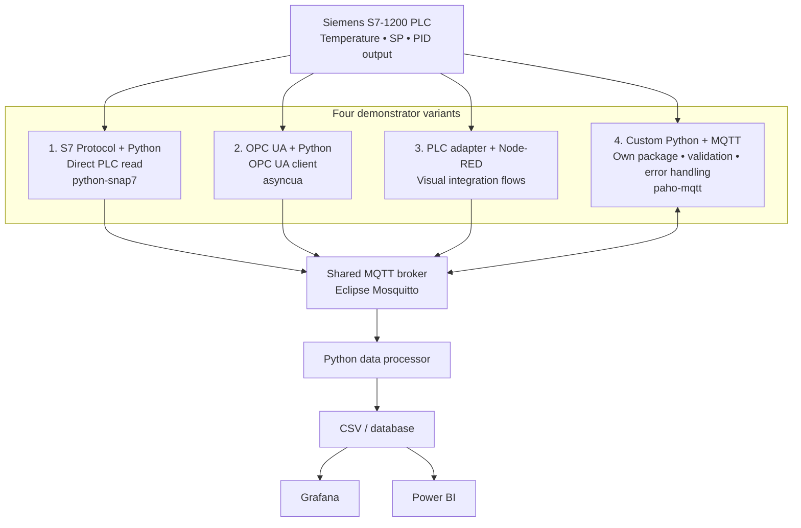

# PLC-to-Edge Integration Options

This page documents the planned demonstrator variants for moving telemetry from the Siemens S7-1200 PLC into the edge platform.

> **Status:** design/planning. The variants, images and flows are not considered implemented or operational until they have been built and tested.

## What each variant demonstrates

| Variant | Main purpose | Important dependency / limitation |
|---|---|---|
| `industry-s7-demo` | Read PLC values directly over the Siemens S7 protocol and optionally publish them to MQTT | PLC access, compatible library and communication permissions must be configured |
| `industry-opcua-demo` | Read PLC values through an OPC UA client and optionally publish them to MQTT | Requires an OPC UA server supported by the exact CPU/firmware and correctly configured in the PLC |
| `industry-nodered-demo` | Use Node-RED flows to adapt the PLC data source and publish telemetry to MQTT | Requires a suitable Node-RED node/driver and verified PLC connectivity |
| `industry-mqtt-demo` | Demonstrate MQTT publishing/subscribing and custom Python processing using `paho-mqtt` | MQTT itself does not read PLC memory; this demo can use simulated telemetry or consume data published by another adapter |

## Demo and live modes

Each demonstrator should provide two clearly documented modes:

- **Demo mode:** generates or uses simulated telemetry so the image can be shown without a connected PLC.
- **Live mode:** connects to the configured PLC or MQTT broker. This mode requires the relevant external service, network access and credentials/configuration.

The MQTT broker is a shared service, not bundled as a hidden dependency inside every adapter image. For a simple recruiter demo, provide a Compose example that starts Mosquitto and the selected demo image together. Build and test images for `linux/arm64` for the Raspberry Pi 5; optionally add `linux/amd64` for laptop demonstrations.

Each image should have its own directory, `Dockerfile`, example configuration, usage instructions and tests. Start with `industry-mqtt-demo` in demo mode, then add and validate the real PLC adapters one by one.

> **Safety and scope:** begin with read-only telemetry. Keep the PLC's PID and process control local. Do not expose the MQTT broker or Node-RED editor publicly; configure authentication, ACLs and network restrictions before live operation.
