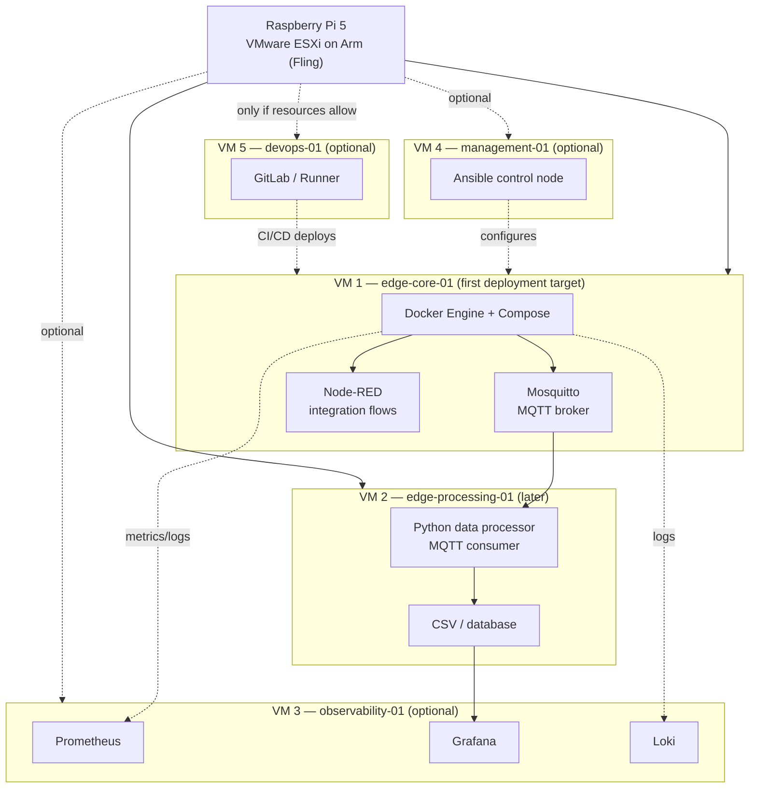
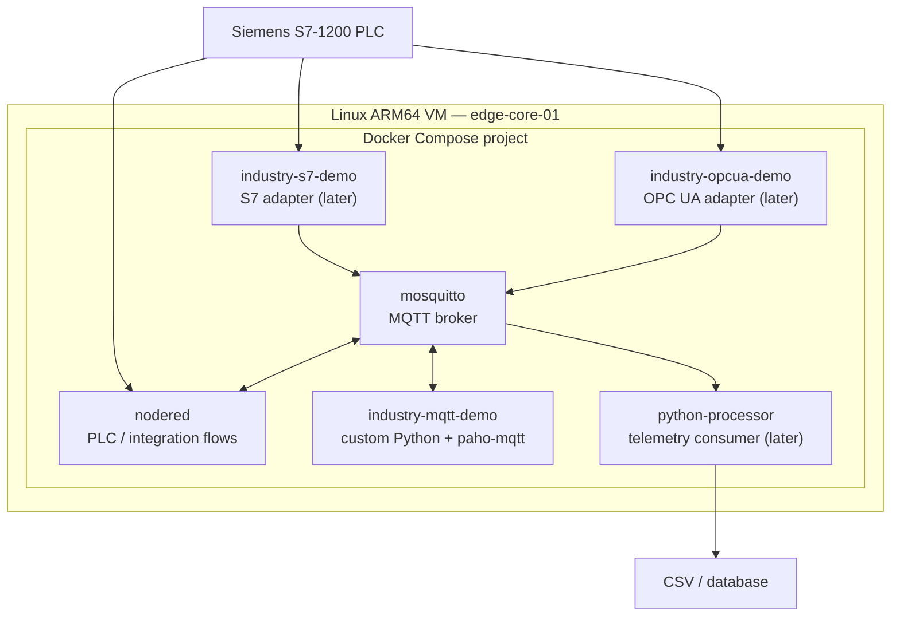
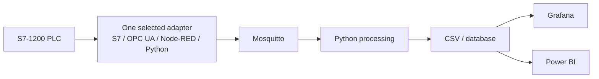

# Virtual Machines and Docker Containers

This page describes the **planned** virtual-machine and container layout for `industry-devops-lab`.

> **Status:** architecture proposal, not a report of the currently deployed environment. Confirm available RAM, storage, ARM64 compatibility and ESXi networking before creating VMs. Start with the smallest working setup and add services only after validating each stage.

## 1. Virtualization overview

The diagram shows logical responsibilities. It does not require every role to be placed on a separate VM. In particular, Ansible can run from the laptop, and GitLab may be too resource-intensive for the Raspberry Pi 5; a remote GitLab service or a separate machine may be more appropriate.

## 2. Planned VM inventory

| VM | Role | Initial services | Priority / notes |
|---|---|---|---|
| `edge-core-01` | Edge integration | Docker Engine, Docker Compose, Mosquitto, Node-RED | **First**; keep the initial footprint small |
| `edge-processing-01` | Data processing | Python MQTT consumer, validation, CSV/database writer | Add after the MQTT path is verified |
| `observability-01` | Monitoring | Prometheus, Grafana, optionally Loki | Later; can be combined with other services if resources are tight |
| `management-01` | Configuration management | Ansible | Optional; can run on the laptop instead |
| `devops-01` | CI/CD | GitLab and/or Runner | Optional; assess RAM, storage and ARM64 support first |
| `communications-01` | Notifications | Optional notification service / Matrix components | Future extension |
| `security-01` | Network security | WireGuard, firewall and related services where appropriate | Future extension; avoid duplicating ESXi or network controls without a clear need |

No fixed CPU, RAM, disk or IP assignments are specified here. Determine these from the actual ESXi host capacity and existing network before deployment.

## 3. Docker layout inside `edge-core-01`

The S7, OPC UA, MQTT demo and Python processor containers are planned components. They do not all need to run at once. Start with Mosquitto and one demo container; add live PLC adapters only after connectivity and access permissions are verified.

### Container responsibilities

| Container / service | Responsibility | Status |
|---|---|---|
| `mosquitto` | Shared MQTT broker | Planned |
| `nodered` | Visual integration flows | Planned |
| `industry-mqtt-demo` | Demonstrate MQTT with custom Python code and simulated telemetry | Planned |
| `industry-s7-demo` | Read PLC values using the S7 protocol and optionally publish to MQTT | Planned |
| `industry-opcua-demo` | Read PLC values through OPC UA and optionally publish to MQTT | Planned; depends on PLC/firmware/configuration support |
| `python-processor` | Validate/process MQTT telemetry and persist it | Planned |

## 4. Proposed data flow

- Keep the PLC's PID and process-control logic local to the PLC.
- Initially use read-only telemetry from the PLC.
- Use simulated data for container demos that should work without physical hardware.
- Configure broker authentication, topic ACLs and network restrictions before live operation.
- Treat diagrams as target design until each service has been implemented and tested.

## 5. Implementation sequence

1. Verify ESXi host capacity, networking and ARM64 guest compatibility.
2. Create one Linux ARM64 VM: `edge-core-01`.
3. Install Docker Engine and Compose; verify both with a simple test container.
4. Start Mosquitto and validate publish/subscribe locally.
5. Build and run `industry-mqtt-demo` in simulation mode.
6. Add Node-RED and verify its MQTT flow.
7. Add the Python processor and persistence.
8. Only then test one real PLC integration path at a time.
9. Add observability and CI/CD if host capacity and project needs justify them.
